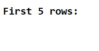
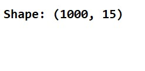
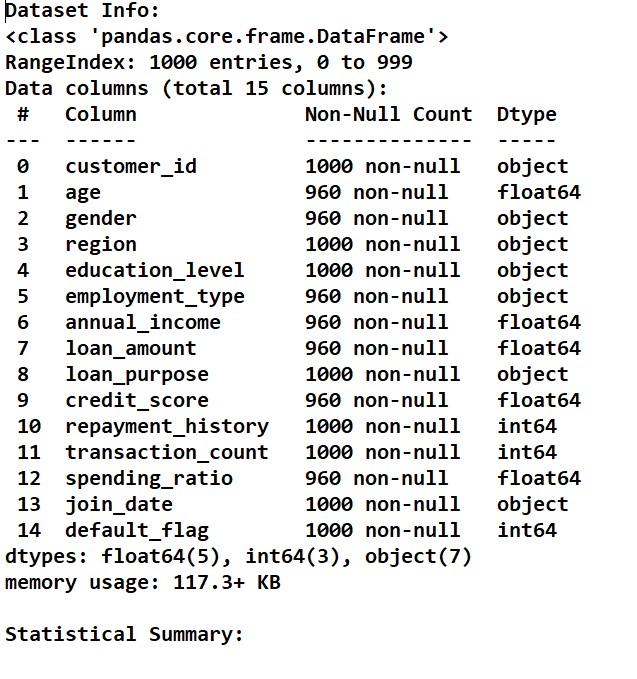
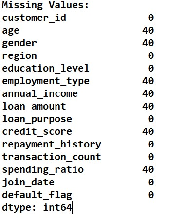
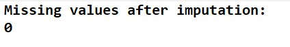
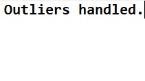
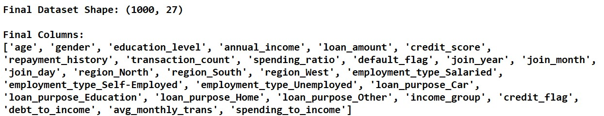
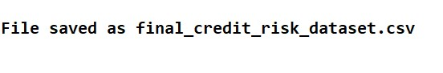

# Customer Credit Risk – Data Preprocessing & Feature Engineering

An end-to-end data preprocessing project that turns a raw **Customer Credit Risk** dataset into a clean, fully numeric dataset ready for a machine learning model that predicts **loan default**.

> **Role:** Junior Data Scientist at a fintech company
> **Goal:** Prepare the data so an ML model can predict whether a customer will default on a loan (`default_flag`: 0 = No, 1 = Yes)

---

## Project Objective

Apply data preprocessing and feature engineering end to end: data understanding, cleaning, imputation, outlier handling, encoding, scaling, transformations and feature construction. The outcome is a fully processed dataset ready for ML modeling.

---

## Folder Structure

```
Final Project Credit_Risk_Project/
├── Credit_Risk_Proje.ipynb                 # Main notebook (all preprocessing steps)
├── customer_credit_risk_dataset_2.csv      # Raw input dataset (1000 rows x 15 columns)
├── final_credit_risk_dataset.csv           # Final processed dataset (1000 rows)
├── final project.txt                       # Short step-by-step summary of the work
├── 1.jpg ... 15.jpg                        # Output screenshots from the notebook
└── README.md
```

---

## Dataset Description

The dataset has **1000 customers** and **15 columns**.

| Column | Type | Description | Preprocessing Used |
|---|---|---|---|
| customer_id | String | Unique customer identifier | Kept as identifier only |
| age | Integer/Float | Age of customer (years) | Mean imputation, scaling |
| gender | Categorical | Male / Female / Other | Mode imputation, Label Encoding |
| region | Categorical | North / South / East / West | One-Hot Encoding |
| education_level | Categorical | Primary / Secondary / Graduate / Post-Graduate | Label Encoding |
| employment_type | Categorical | Salaried / Self-Employed / Unemployed | Mode imputation, One-Hot Encoding |
| annual_income | Float | Annual income (₹) | Imputation, IQR capping, binning, scaling, Yeo-Johnson |
| loan_amount | Float | Loan amount requested (₹) | Imputation, IQR capping, scaling, Yeo-Johnson |
| loan_purpose | Categorical | Home / Car / Education / Business / Other | One-Hot Encoding |
| credit_score | Float | Credit score (300–850) | Imputation, IQR capping, binarization, scaling |
| repayment_history | Integer | Missed payments in last 12 months | Scaling |
| transaction_count | Integer | Transactions in last 6 months | Scaling, feature construction |
| spending_ratio | Float | Spending-to-income ratio (%) | Imputation, IQR capping, scaling |
| join_date | Date | Date the customer joined | Split into year / month / day |
| default_flag | Binary | **Target:** 0 = No default, 1 = Default | Unchanged |

**Target balance (raw data):** 795 non-default vs 205 default (about 20.5% default rate).

**Data issues handled:** missing values in 7 columns (age, gender, employment_type, annual_income, loan_amount, credit_score, spending_ratio), outliers in income / loan / credit / spending columns, skewed distributions, a text-format date column and several categorical columns.

---

## Preprocessing Pipeline

### 1. Data Loading & Understanding
Loaded the CSV with Pandas and inspected it using `head()`, `shape`, `info()`, `describe()` and `isnull().sum()`.
Screenshots: `1.jpg` – `5.jpg`

### 2. Missing Value Handling
- **Numerical columns:** `SimpleImputer(strategy='mean')`
- **Categorical columns:** `SimpleImputer(strategy='most_frequent')`
- Result: **0 missing values** remaining (`6.jpg`)

### 3. Outlier Handling (IQR Method)
Capped values outside `[Q1 - 1.5×IQR, Q3 + 1.5×IQR]` for `annual_income`, `loan_amount`, `credit_score` and `spending_ratio`. Values were **capped, not deleted**, so all 1000 rows are kept. (`7.jpg`)

### 4. Date & Time Feature Extraction
Converted `join_date` to datetime and extracted `join_year`, `join_month` and `join_day`, then dropped the original column. (`8.jpg`)

### 5. Encoding Categorical Variables
- **Label Encoding:** `gender`, `education_level`
- **One-Hot Encoding** (`drop_first=True`): `region`, `employment_type`, `loan_purpose`

(`9.jpg`)

### 6. Binning & Binarization
- `income_group`: `annual_income` split into 3 equal-width bins (Low / Medium / High)
- `credit_flag`: 1 if `credit_score > 700`, else 0

(`10.jpg`)

### 7. Feature Scaling
`StandardScaler` (Z-score) applied to: age, annual_income, loan_amount, credit_score, repayment_history, transaction_count and spending_ratio. (`11.jpg`)

### 8. Feature Construction

| New Feature | Formula | Purpose |
|---|---|---|
| debt_to_income | loan_amount / (annual_income + 1) | Repayment burden |
| avg_monthly_trans | transaction_count / 6 | Average monthly activity |
| spending_to_income | spending_ratio / (annual_income + 1) | Spending relative to earnings |

(`12.jpg`)

### 9. Power Transformation
`PowerTransformer(method='yeo-johnson')` applied to `loan_amount` and `annual_income` to reduce skewness. (`13.jpg`)

### 10. Final Output
The cleaned dataset is saved as `final_credit_risk_dataset.csv`. (`14.jpg`, `15.jpg`)

---

## Results

| Item | Before | After |
|---|---|---|
| Rows | 1000 | 1000 |
| Columns | 15 | 28 (as saved in the CSV, including `customer_id`) |
| Missing values | Present in 7 columns | 0 |
| Outliers | Present | Capped with IQR |
| Text columns | Multiple text columns | All converted to numbers |
| New features | – | 3 constructed + 3 date parts + `income_group` + `credit_flag` |

---

## Screenshots

| Step | Preview |
|---|---|
| Libraries loaded |  |
| First 5 rows |  |
| Dataset shape |  |
| Info and describe |  |
| Missing values |  |
| After imputation |  |
| Outliers handled |  |
| Date features |  |
| Encoding |  |
| Binning |  |
| Scaling |  |
| New features |  |
| Power transform |  |
| Final shape and columns |  |
| File saved |  |

---

## Tech Stack

- Python 3
- Pandas, NumPy
- Matplotlib, Seaborn
- Scikit-learn (`SimpleImputer`, `LabelEncoder`, `StandardScaler`, `PowerTransformer`)
- Jupyter Notebook

---

## How to Run

```bash
pip install pandas numpy matplotlib seaborn scikit-learn jupyter
jupyter notebook Credit_Risk_Proje.ipynb
```

Make sure the input CSV path in the data-loading cell points to `customer_credit_risk_dataset_2.csv`.

---

## Author

**Subhash**
BCA (Semester 5), Veer Narmad South Gujarat University (VNSGU)
Aspiring AI/ML practitioner
